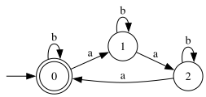
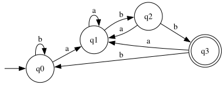
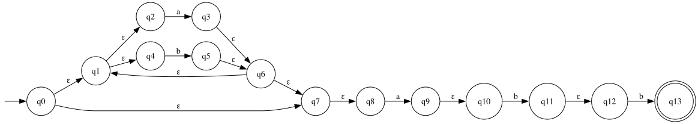
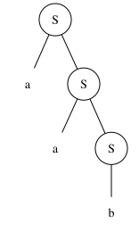
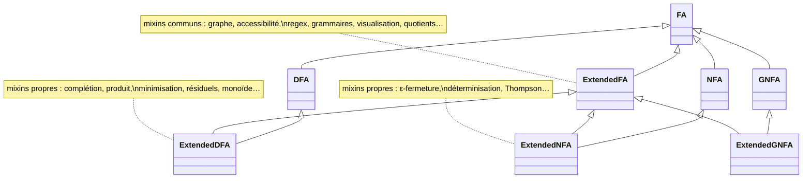

# automata-extensions

Extension pédagogique de [automata-lib](https://github.com/caleb531/automata) **9.2.0** pour un
cours de théorie des langages : algorithmes classiques sur les automates finis, expressions
régulières, grammaires régulières, monoïdes syntaxiques, visualisation, exercices corrigés.

La bibliothèque d'origine n'est **jamais modifiée** : tout est ajouté par héritage et *mixins*
(`ExtendedDFA`, `ExtendedNFA`, `ExtendedGNFA`), si bien que les objets restent de vrais
`DFA`/`NFA`/`GNFA` d'automata-lib.



## Installation

```bash
git clone https://github.com/<votre-compte>/automata-extensions.git
cd automata-extensions
python -m venv .venv && source .venv/bin/activate
pip install -e ".[dev]"
```

Optionnel (rendu SVG/PNG/PDF, compilation du TikZ) — sous Arch Linux :

```bash
sudo pacman -S --needed graphviz texlive-pictures texlive-latexextra
```

Sans Graphviz, tout fonctionne sauf `svg()`, `png()`, `pdf()` et `save()` ; `dot()`, `tikz()`,
`latex()` et `animate()` sont produits en Python pur.

## Démarrage rapide

Les exemples ci-dessous sont **exécutés par les tests** : la valeur après `# ->` est celle
réellement obtenue.

```python
from automata_extensions import ExtendedDFA, ExtendedNFA

# mots sur {a,b} dont le nombre de a est multiple de 3
d = ExtendedDFA(
    states={"0", "1", "2"}, input_symbols={"a", "b"},
    transitions={"0": {"a": "1", "b": "0"},
                 "1": {"a": "2", "b": "1"},
                 "2": {"a": "0", "b": "2"}},
    initial_state="0", final_states={"0"},
)
d.accepts("aaa")  # -> True
d.accepts("aab")  # -> False
d.run("aab")  # -> '0 → 1 → 2 → 2 → reject'
d.execution_trace("ab")  # -> [('0', 'a', '1'), ('1', 'b', '1')]
```

### Du langage à l'expression, et à l'algèbre

```python
d.to_regex()  # -> '(ab*ab*a|b)*'
d.is_minimal()  # -> True
d.residuals()  # -> {'q0': '', 'q1': 'a', 'q2': 'aa'}
len(d.syntactic_monoid())  # -> 3
d.is_star_free()  # -> False
[sorted(c) for c in d.strongly_connected_components()]  # -> [['0', '1', '2']]
d.pair_table_str(show_round=True)  # -> ' 0 1\n1 0\n2 0 1'
```

`is_star_free()` applique le théorème de Schützenberger : ce langage a pour monoïde syntaxique le
groupe ℤ/3ℤ, qui n'est pas apériodique, donc il n'est pas exprimable sans étoile de Kleene.

### Composition : rien n'est jamais modifié sur place

Chaque transformation renvoie un **nouvel** automate, ce qui permet d'écrire les algorithmes
comme des formules :

```python
dfa = ExtendedDFA.from_regex("(a|b)*abb")
len(dfa.states)  # -> 4
dfa.shortest_word()  # -> 'abb'
dfa.reverse().determinize().minimize().is_equivalent(ExtendedDFA.from_regex("bba(a|b)*"))  # -> True
dfa.distinguishing_word(ExtendedDFA.from_regex("(a|b)*ab"))  # -> 'ab'
```

`distinguishing_word` renvoie un **mot contre-exemple** : le plus court mot que l'un des deux
automates accepte et pas l'autre (`None` s'ils sont équivalents).

### Expressions régulières : AST, dérivées, Glushkov, Thompson

```python
from automata_extensions import parse_regex

r = parse_regex("(a|b)*abb")
r.firstpos()  # -> frozenset({1, 2, 3})
r.followpos()[3]  # -> frozenset({4})
str(parse_regex("(a|())*b**").simplify())  # -> 'a*b*'
str(r.simplify().derivative("a"))  # -> '(a|b)*abb|bb'
ExtendedNFA.from_regex("(a|b)*abb").determinize().is_equivalent(dfa)  # -> True
```

### Grammaires et équations de langages

```python
d.derivation_tree("aaa").sequence()  # -> '0 => a1 => aa2 => aaa0 => aaa'
str(d.to_grammar())  # -> '0 -> a1 | b0 | ε\n1 -> a2 | b1\n2 -> a0 | b2'
ExtendedNFA.from_grammar_string("S -> aS | b").accepts("aab")  # -> True
str(d.to_equations())  # -> 'X0 = bX0 | aX1 | ε\nX1 = bX1 | aX2\nX2 = aX0 | bX2'
str(d.to_equations().solve()["0"])  # -> 'b*|b*ab*a(ab*ab*a|b)*ab*'
```

### Exercices corrigés automatiquement

La correction compare des **langages**, pas des textes : toute réponse correcte est acceptée, et
une réponse fausse reçoit un contre-exemple vérifiable.

```python
from automata_extensions.exercises import generate

ex = generate("minimize", seed=3)       # même graine = même exercice
ex.check(ex.solution)  # -> True
ex.feedback(ex.given)  # -> "Le langage est correct, mais l'automate n'est pas minimal (6 états au lieu de 3)."
generate("dfa_to_regex", seed=0).feedback("a*")  # -> "Votre réponse et la solution diffèrent sur le mot « ε » : votre réponse l'accepte mais pas la solution."
```

Types disponibles : `dfa_to_regex`, `regex_to_dfa`, `minimize`, `determinize`.

## Visualisation

```python notest
d.save("d.svg")                          # aussi .png, .pdf, .dot, .tex
d.latex()                                # document LaTeX autonome (TikZ)
d.animate("aab", path="animation.html")  # page HTML interactive, sans dépendance
d                                        # dans Jupyter : le diagramme s'affiche
```

| Automate des `a` multiples de 3 | `(a\|b)*abb`, DFA minimal |
|:---:|:---:|
|  |  |

NFA de Thompson de `(a|b)*abb` (14 états, ε-transitions) et arbre de dérivation de `aab` dans
`S -> aS | b` :





Animations interactives (à ouvrir dans un navigateur) :
[DFA](docs/img/animation_dfa.html), [NFA de Thompson](docs/img/animation_nfa.html).

## Fonctionnalités

| Domaine | Méthodes principales |
|---|---|
| Graphe | `bfs`, `dfs`, `accessible_states`, `coaccessible_states`, `useful_states`, `trim`, `strongly_connected_components`, `has_cycle`, `is_empty`, `is_finite`, `induced_subautomaton` |
| DFA | `complete`, `complement`, `intersection`, `union`, `difference`, `product`, `is_included_in`, `is_equivalent`, `is_isomorphic_to`, `is_prefix_closed` |
| Minimisation | `pair_table`, `equivalence_classes`, `minimize`, `brzozowski_minimize`, `residual_automaton`, `syntactic_monoid`, `is_star_free` |
| NFA | `epsilon_closure`, `remove_epsilon_transitions`, `determinize`, `reverse`, `union`, `concatenation`, `kleene_star`, `left_quotient_word`, `right_quotient_word` |
| Regex | `to_regex`, `to_regex_arden`, `to_regex_optimum`, `parse_regex` (AST, `derivative`, `firstpos`…), `from_regex` (Thompson, dérivées, Glushkov) |
| Équations | `arden`, `EquationSystem`, `to_equations`, `GNFA.eliminate_state` |
| Grammaires | `Grammar`, `to_grammar`, `to_left_grammar`, `from_grammar_string`, `derive`, `derivation_tree`, `parse_tree` |
| Simulation | `accepts`, `run`, `execution_trace`, `animate` |
| Preuves et exercices | `shortest_word`, `distinguishing_word`, `exercises.generate` |

Chaque méthode a une docstring avec sa **complexité** : voir [docs/API.md](docs/API.md)
(généré) et [docs/ALGORITHMES.md](docs/ALGORITHMES.md) (explication des algorithmes).

## Architecture



```text
src/automata_extensions/
├── fa/            ExtendedFA/DFA/NFA/GNFA et leurs mixins (fa_mixins, dfa_mixins, nfa_mixins, gnfa_mixins)
├── regex/         AST, parseur, dérivées de Brzozowski, positions de Glushkov
├── grammar/       Grammar, DerivationStep, ParseTree
├── algebra/       TransitionMonoid (monoïde de transitions / syntaxique)
├── equations.py   lemme d'Arden, systèmes d'équations
├── exercises.py   générateur d'exercices corrigés
└── utils/         correctif cached_method, rendu Graphviz, ordres déterministes
```

Règle : un algorithme qui ne dépend que des états, transitions, état initial et états finaux
est écrit **une seule fois** au niveau `ExtendedFA` ; seuls les algorithmes propres au
déterminisme ou aux ε-transitions vivent dans `ExtendedDFA` / `ExtendedNFA`.

## Conventions

- **Immuabilité** : aucune méthode ne modifie `self` ; une transformation renvoie un nouvel automate.
- **Nommage** : calculs `accessible_states()`, prédicats `is_trim()`, conversions `to_regex()`.
  Les suffixes `_graph` (`successors_graph`) et `_word` (`left_quotient_word`) évitent toute
  collision avec les méthodes homonymes d'automata-lib, qui portent sur des mots ou des automates.
- **Pédagogie d'abord** : algorithmes lisibles, proches des démonstrations, sans optimisation
  prématurée ; la complexité est indiquée dans chaque docstring.
- **Correctif** : un bug de `cached_method` (dépendance d'automata-lib) faisait échouer
  `(d - d).isempty()` ; `automata_extensions` le corrige à l'import, y compris pour les `DFA` purs.

## Écarts avec la documentation de référence (PDF)

- `to_regex()` délègue à `GNFA.to_regex()` d'automata-lib, comme le demande le cahier des
  charges (ne pas réimplémenter l'existant) ; son texte diffère de celui du PDF, pas le langage.
- `NFA.from_grammar_string("S -> aS | b").accepts_input("aab")` vaut `True` ici : le `False` du
  PDF est une erreur (`S ⇒ aS ⇒ aaS ⇒ aab`).
- `animate` est défini au niveau `ExtendedFA` (il fonctionne aussi pour les NFA).
- `pair_table_str` reproduit le format du PDF, sans alignement de colonnes pour les noms
  d'états de plusieurs caractères.

## Limites connues

- `derive`, `Grammar.to_nfa` ne gèrent que les grammaires **régulières** (pas d'analyse
  hors-contexte, pas de `to_pda`).
- Pas d'automates à pile ni de machines de Turing étendus, pas d'interface `Language` unifiée.
- Placement des diagrammes en colonnes simples : un automate très dense peut avoir des
  étiquettes qui se frôlent.
- `ExtendedNFA.from_regex` ne gère que `| * + ? ()` (pas `&`, `.`, `{n,m}` d'automata-lib).

## Tests

```bash
python -m pytest -q                      # toute la suite
python -m pytest --cov=automata_extensions --cov-report=term-missing
python docs/gen_api.py --check           # chaque méthode publique a une docstring
```

La suite comprend des tests de **propriétés** comparés à des définitions indépendantes
(force brute sur les mots, accessibilité mutuelle pour les composantes connexes, etc.), un test
de **couverture du cahier des charges** (`tests/test_spec_coverage.py`) et, si les outils sont
installés, de vraies compilations LaTeX, rendus Graphviz et exécutions JavaScript.

## Références

- Hopcroft, Motwani, Ullman, *Introduction to Automata Theory, Languages, and Computation*.
- Brzozowski, « Derivatives of Regular Expressions », *JACM* (1964).
- Tarjan, « Depth-first search and linear graph algorithms », *SIAM J. Comput.* (1972).
- Thompson (1968) ; Glushkov (1961) ; Schützenberger (1965) ; Nerode (1958).

## Licence

MIT — voir [LICENSE](LICENSE). Historique : [CHANGELOG.md](CHANGELOG.md).
